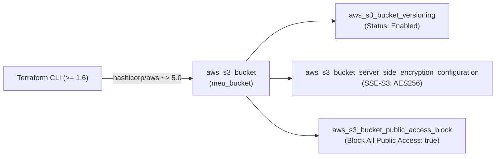
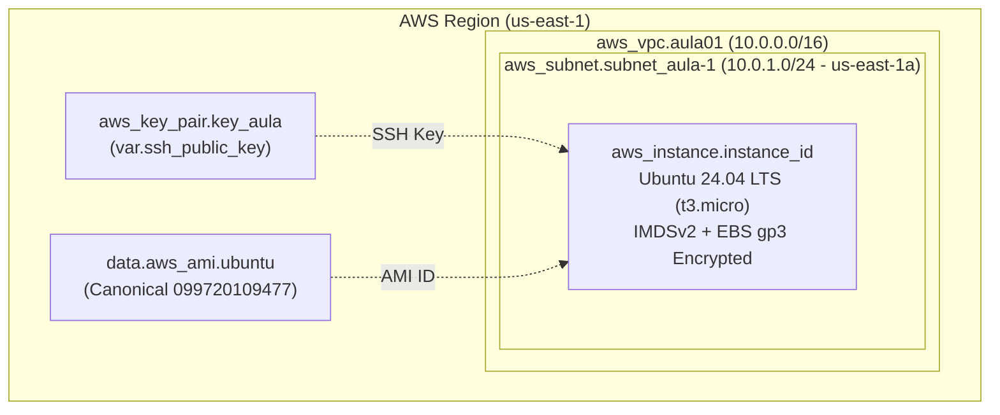

# Aula 01 — Fundamentos de IaC com Terraform na AWS (S3, VPC, Subnet e EC2)


-E95420?logo=ubuntu&logoColor=white)


Repositório prático da **Aula 01** da formação **Acelera DevOps & MBA Platform Engineering**, ministrada por **Erik Tonon**. O laboratório está dividido em duas etapas progressivas:
- **Parte 1 (Raiz `.`)**: Provisionamento seguro de um Bucket Amazon S3 seguindo o padrão modular do AWS Provider v5+ (Versionamento, Criptografia Server-Side AES-256 e Bloqueio Total de Acesso Público).
- **Parte 2 ([`parte2/`](./parte2))**: Construção da primeira topologia de rede na AWS com **VPC**, **Subnet Pública**, **Key Pair SSH** e **Instância EC2 Ubuntu 24.04 LTS (`t3.micro`)** endurecida com **IMDSv2** e disco **EBS gp3 criptografado**.

---

## Arquitetura dos Laboratórios

### Parte 1 — Governança e Segurança de Bucket S3 (AWS Provider v5)



### Parte 2 — Primeira VPC, Subnet e Instância EC2 ([`parte2/`](./parte2))



---

## Pré-requisitos

1. **Terraform CLI** (`>= 1.6.0`): [Guia Oficial de Instalação](https://developer.hashicorp.com/terraform/tutorials/aws-get-started/install-cli)
2. **AWS CLI v2**: [Guia Oficial de Instalação](https://docs.aws.amazon.com/cli/latest/userguide/getting-started-install.html)
3. **Credenciais AWS configuradas**:
   ```bash
   aws configure
   # Ou via variáveis de ambiente:
   export AWS_ACCESS_KEY_ID="SEU_ACCESS_KEY"
   export AWS_SECRET_ACCESS_KEY="SEU_SECRET_KEY"
   export AWS_DEFAULT_REGION="us-east-1"
   ```

---

## Estrutura do Repositório

```text
aula-01-iac/
├── .github/workflows/terraform.yml  # Pipeline CI (fmt + validate nas Partes 1 e 2)
├── main.tf                          # Parte 1: Bucket S3 + Versionamento + Criptografia + Public Access Block
├── variables.tf                     # Parte 1: Variáveis parametrizáveis (aws_region, bucket_prefix, environment)
├── outputs.tf                       # Parte 1: Outputs (bucket_id, bucket_arn)
├── versions.tf                      # Parte 1: Constraints de versão do Terraform e AWS Provider v5
└── parte2/                          # Parte 2: Laboratório de VPC + Subnet + EC2
    ├── main.tf                      # Configuração do Provider AWS
    ├── vpc.tf                       # Recurso aws_vpc com DNS habilitado
    ├── subnet.tf                    # Recurso aws_subnet com IP público automático
    ├── ec2.tf                       # Data source AMI Ubuntu 24.04 LTS + Key Pair + EC2 t3.micro (IMDSv2)
    ├── variables.tf                 # Variáveis de rede, instância e chave SSH
    ├── outputs.tf                   # Outputs de VPC, Subnet, Instance ID e IP Público
    ├── versions.tf                  # Constraints do Terraform e AWS Provider v5
    └── README.md                    # Guia dedicado da Parte 2
```

---

## Passo a Passo — Parte 1: Bucket S3 Seguro

### 1. Inicializar o diretório de trabalho
Baixa o plugin `hashicorp/aws` (`~> 5.0`) e prepara o diretório local:
```bash
terraform init
```

### 2. Validar formatação e sintaxe HCL
```bash
terraform fmt -check
terraform validate
```

### 3. Inspecionar o plano de execução
```bash
terraform plan -out=tfplan
```

### 4. Aplicar a infraestrutura na AWS
```bash
terraform apply tfplan
```

### 5. Limpeza de recursos (Evitar cobranças na AWS)
Ao finalizar o laboratório, destrua os recursos provisionados:
```bash
terraform destroy -auto-approve
```

---

## Passo a Passo — Parte 2: VPC, Subnet e EC2

Para executar o laboratório de rede e computação, acesse o diretório [`parte2/`](./parte2):

```bash
cd parte2
terraform init
terraform validate
terraform plan -var="ssh_public_key=$(cat ~/.ssh/id_ed25519.pub)"
terraform apply -var="ssh_public_key=$(cat ~/.ssh/id_ed25519.pub)"
```

Consulte o [README da Parte 2](./parte2/README.md) para mais detalhes.
