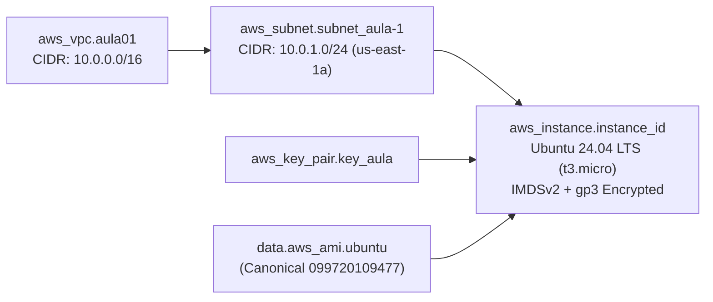

# Aula 01 (Parte 2) — Primeira VPC, Subnet e Instância EC2 na AWS


-E95420?logo=ubuntu&logoColor=white)

Nesta segunda etapa da **Aula 01**, saímos de um recurso isolado de armazenamento (S3) para provisionar uma topologia de rede e computação interconectada na AWS utilizando referências implícitas de atributos entre recursos no Terraform.

---

## Topologia Provisionada



---

## Destaques Técnicos e Boas Práticas Aplicadas

- **Descoberta Dinâmica de AMI (`data "aws_ami" "ubuntu"`)**: Busca automaticamente a imagem mais recente do **Ubuntu Server 24.04 LTS (Noble Numbat)** publicada oficialmente pela Canonical (`099720109477`) com volumes SSD `gp3`.
- **Instância Moderna (`t3.micro`)**: Substitui a geração legada `t2.micro` pela família `t3.micro` (Nitro Hypervisor, melhor performance de CPU/rede e elegível ao Free Tier).
- **Segurança de Metadados (IMDSv2)**: Exige tokens de sessão (`http_tokens = "required"`) para mitigar vulnerabilidades de SSRF no serviço de metadados da instância.
- **Volume Root Criptografado (`gp3`)**: Configura armazenamento `gp3` de 10 GB com criptografia EBS nativa (`encrypted = true`).

---

## Como Executar

### 1. Gere um par de chaves SSH (caso ainda não possua)
```bash
ssh-keygen -t ed25519 -C "aluno@acelera-devops" -f ~/.ssh/aula01_key -N ""
```

### 2. Inicialize e valide o Terraform
```bash
cd parte2
terraform init
terraform fmt -check
terraform validate
```

### 3. Planeje e aplique passando sua chave pública SSH
```bash
terraform plan -var="ssh_public_key=$(cat ~/.ssh/aula01_key.pub)"
terraform apply -var="ssh_public_key=$(cat ~/.ssh/aula01_key.pub)"
```

### 4. Destrua o ambiente ao encerrar os testes
```bash
terraform destroy -auto-approve
```
